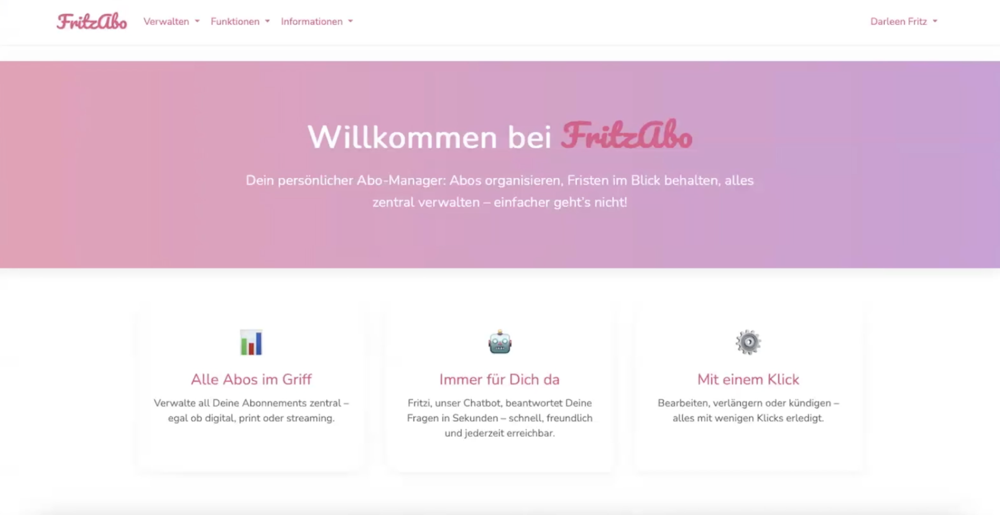
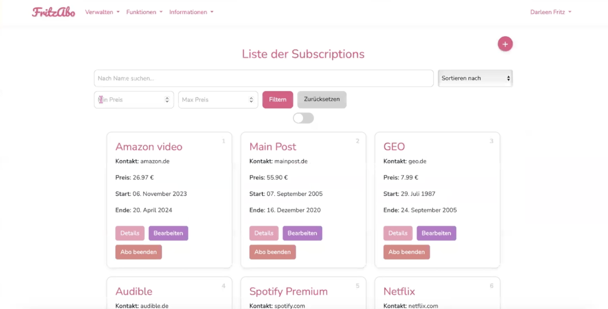
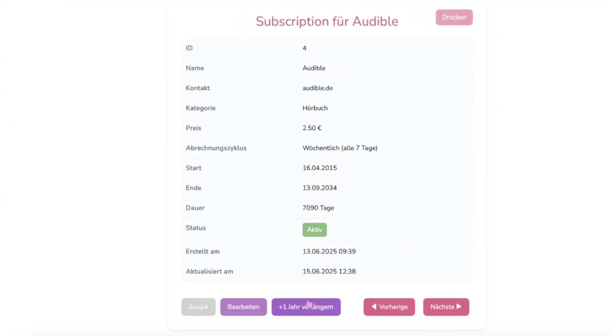
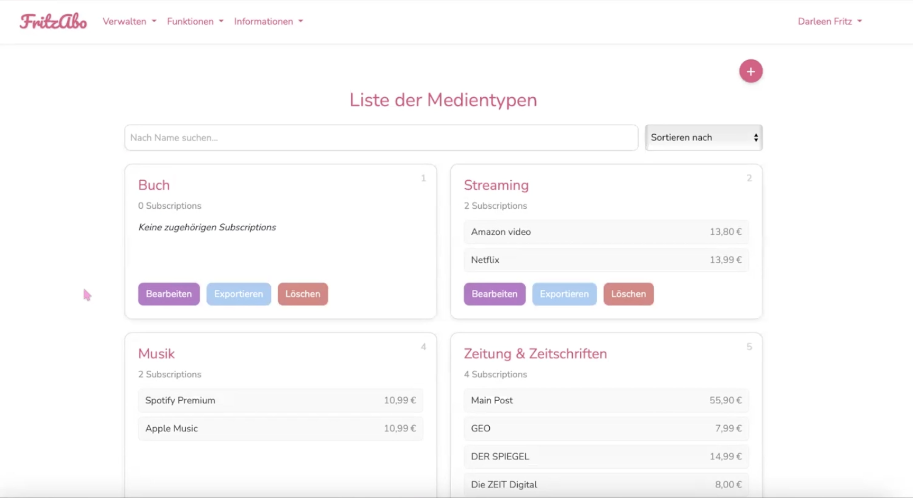

# FritzAbo

Eine Webanwendung zur Verwaltung von Abonnements, entwickelt mit Laravel. Streaming, Musik, Zeitungen oder Hörbücher lassen sich an einem Ort erfassen, nach Medientyp und Abrechnungszyklus ordnen, durchsuchen und als CSV exportieren.



## Hintergrund

FritzAbo entstand als Einzelarbeit im Modul „Webanwendungen“ im Studiengang E-Commerce an der Technischen Hochschule Würzburg-Schweinfurt (THWS), Sommersemester 2025.

**Hinweis:** FritzAbo ist ein Studienprojekt und kein echtes Unternehmen. Die Anwendung ist ein Prototyp zum Lernen und Vorführen, nicht für den echten Einsatz gedacht. Einige Elemente sind nur angedeutet, zum Beispiel der Knopf „Abo beenden“ in der Übersicht. Impressum, Datenschutz und Kontakt sind Beispielseiten.

## Funktionen

**Abonnements**
- Abos anlegen, ansehen, bearbeiten und löschen
- Pro Abo: Name, Kontakt, Medientyp, Preis, Abrechnungszyklus, Start und Ende
- Detailansicht mit Laufzeit in Tagen, Status (aktiv oder abgelaufen), Druckansicht und Blättern zum vorherigen oder nächsten Abo
- Verlängern um ein Jahr mit einem Klick
- Suche nach Namen mit Vorschlägen, Sortierung und Filter nach Preisspanne

**Medientypen und Abrechnungszyklen**
- Eigene Bereiche zum Anlegen, Bearbeiten und Löschen, zum Beispiel „Streaming“ oder „Wöchentlich (alle 7 Tage)“
- Übersicht, welche Abos zu einem Medientyp oder Zyklus gehören
- Export der zugehörigen Abos als CSV-Datei

**Weiteres**
- Registrierung, Login und Passwort zurücksetzen
- Jedes Abo gehört zu einem Benutzerkonto, Zugriffe werden über eine Policy geprüft
- Feedback-Formular
- „Fritzi“, ein kleiner Chatbot auf der Kontaktseite, der auf Stichwörter mit festen Antworten reagiert

## Screenshots

| Abo-Übersicht | Abo-Details |
| --- | --- |
|  |  |



## Technik

| Bereich | Umsetzung |
| --- | --- |
| Backend | PHP 8.2, Laravel 12 |
| Frontend | Blade-Templates, Bootstrap 5, Vite |
| Datenbank | MySQL 8 |
| Entwicklungsumgebung | Laravel Sail (Docker) |
| Anmeldung | Laravel UI Auth |

Die Anwendung folgt dem MVC-Prinzip von Laravel: Modelle für `Subscription`, `Mediatype`, `Billingcycle` und `User`, Resource-Controller für die drei Bereiche, Form Requests für die Validierung und eine `SubscriptionPolicy` für die Berechtigungen. Testdaten erzeugt eine Factory mit 50 Beispiel-Abos.

## Lokal starten

Voraussetzungen: PHP 8.2, Composer und Docker Desktop.

1. Repository klonen und PHP-Abhängigkeiten installieren:
   ```
   git clone https://github.com/darleenfritz/fritzabo.git
   cd fritzabo
   composer install
   ```
2. Umgebungsdatei anlegen:
   ```
   cp .env.example .env
   ```
3. Container starten, Schlüssel erzeugen und Datenbank mit Testdaten füllen:
   ```
   ./vendor/bin/sail up -d
   ./vendor/bin/sail artisan key:generate
   ./vendor/bin/sail artisan migrate --seed
   ```
4. Frontend bauen:
   ```
   ./vendor/bin/sail npm install
   ./vendor/bin/sail npm run dev
   ```
5. Die Anwendung ist danach unter `http://localhost` erreichbar.

## Autorin

Darleen Fritz, Studentin E-Commerce an der THWS
